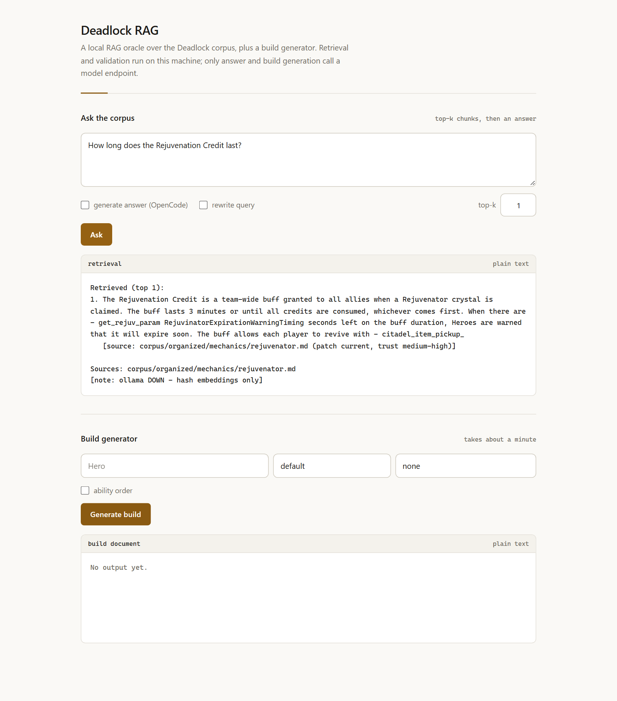

# Deadlock Build Generator

[](https://github.com/gustavomgama/deadlock-build-generator/actions/workflows/ci.yml)

[Portfolio site](https://gustavomgama.github.io/deadlock-build-generator/) · [Case study](docs/CASE_STUDY.md)

Generate original item builds for [Deadlock](https://www.playdeadlock.com/) from a local
knowledge base, then encode them into a game-importable build code — and refuse to emit
anything that does not decode and validate.

No vector database, no cloud storage, no scraping at runtime. The whole system is stdlib
Python plus a small zstd/protobuf codec.

```
$ python buildgen.py Infernus --role "spirit burn carry"
...
## 11. Validation

| check | result |
| --- | --- |
| encode | ok |
| round-trip decode | ok |
| validate | VALID |
| id resolution | ok |

KLUv/WBcBVUcABaxpkPw2qQDcvGk6PHRfoQtjUccGUVqTmY2UYkRhJGBOlO5MSFblm5LuSxOe5O0iTQF9w+P9pUdrsXPiqRQoOS70s7VhiUkgQCbAKAAkmnd57r6tuS4X6SsYW8+jbb8frsy5zV6m0XuDeVV8p6yptuf5PTK1Mv2RLs1u6X9cVzZW93Tbt901XQzyVsp199ZtzmvnbfS0/b7va281ZUcu/0oZdVK6qVQ1al3vxtZuuZ0rrwwwxOhNhd72y+1EBa8J2mvJIcDDkY7SmBTgIQFPIB0MYFdEJbxcSEEA2KQMBqhMqgwMWJwo0mvc26/XTfOVz16anJb3U3zpmxNc1qXQufV/g8kTF1TImDkRIod2AUHJNnJycEuaPNEyo0q2AUD+BDpgMEuCOAHig4N7IIkGRCyADGyMJpw862ZSW+hesW/dK42o7yF2LmpNFCOrPaw34C2dJZn2K16a5tjuopbZ3xUBAjLO6v09Q8TQcmGKEiRGOyCNTs6ePQQRbky1KNjVXf3KBwV18rSub73XJ21p9rflDXKcSl8Z0y1ztvgJpSAEkmHUJGWHictvGAXnPmxZQgQdkEBQnx0muRo6v037VbOjrvVdGLoYKIpDaAiReinhg6XISZWbDyh0fPlBHbBEt/bO0cd51f6Zv0f15/fcTyriBGmzDkAJWwMlqAXQzs2lgAp0kMEuyBNNDmmAMWw0clB8oXEhecFjjFkSKQyCWYK1IQJirEFMwBnoJRwVC071jpT+85yFvVe5WVNNencVEnPYvv2e9KkcyZUZNqyNQWlawbQkRU8V4KmFPnIwvODIsoOdkGSEkh6sGm+7fuuVl6qs6VzT62SHf33VJ96qY9r2a39opz7eamt8LRbL3lbY44z9qqHcFN9/6aRu2uoUZ0ySpmaaEREJIWVDoACERnJ9REwoTIaiVBpDMMYSL6xPno2SVQh1X3ehQ6Sb62P7twLEu5HZanBF4T8CEVLR9LGAFrIBm/YUM5wMQI5CnybZPTbhv54jfdYL1twzeqiM+okcuHhbaV+Y8P027inmJ3I1FarHnp+3oxQaVoMXaDPEJFOSBKwBfGAfbebSED2ozXpiOkEnn8MQRB7cFabNMYnhoxTwziJx5t2Er5yiZrL8p/2QWM4qDTezhJcX5GSQopFOcW3fAQLCmvlNmJaN8y1KY5AY04TlBv6PdTPGLkvvUWbQm+qGrD/AQ==
```

The same build rendered as a full document, with phases, swaps, matchup notes and cited
evidence, is in [`docs/example-infernus.md`](docs/example-infernus.md).
The engineering write-up (problem, tradeoffs, what I would change) is in
[`docs/CASE_STUDY.md`](docs/CASE_STUDY.md).

## What it does

| Component | Job |
| --- | --- |
| `rag.py` | Local retrieval oracle: indexes a curated Deadlock corpus (563 documents) into 3,101 chunks, hybrid BM25 + cosine + MMR retrieval, scope gate, abstention |
| `buildgen.py` | Retrieves hero/ability/item/mechanic facts, plans a build, resolves every ID against live game data, encodes it, decodes it back, validates it |
| `webui.py` | Dependency-free `http.server` UI over both of the above |
| `eval.py` | Retrieval harness: recall@k and abstention accuracy per category |
| `eval_builds.py` | End-to-end build harness: generates, encodes, decodes, validates, scores |
| `validate_build.py` | Structural validator: hero, categories, tier/slot legality, duplicate and unknown IDs, ability-order currency rules |
| `codec/` | Vendored build-code codec: base64 → zstd → protobuf, both directions, MIT |

## How a build is produced

```
corpus/ (markdown)  data/ (items + heroes JSON)
        |                    |
        +--------+-----------+
                 |
             rag.py  -- retrieve (question, top_k, MMR)
                 |
           buildgen.py
                 |
   1. template loaded from build-template.md
   2. prompt = template + retrieved facts + legal item candidates (tier/slot)
   3. model returns JSON plan (6 required categories, swaps, evidence)
   4. every name is resolved to a real id -- unknown names are rejected, never invented
   5. encode: JSON -> protobuf -> zstd -> base64
   6. decode the result and compare hero, then run validate_build.py
   7. only a code that passes 5-6 is printed
```

The invariant is the point: **the generator cannot print a build code that it has not
decoded and validated**. `encode_and_validate` raises instead of returning a bad code, and
`eval_builds.py` scores the whole chain rather than the model's text.

## Design notes

- **JSON index, not a vector DB.** 3,101 chunks load in a few seconds and behave predictably
  on a laptop. Pickle sidecar for faster reloads, JSON remains the source of truth.
- **Embedding fallback.** Uses Ollama `nomic-embed-text` when it is up, otherwise a hashed
  embedder, so retrieval never hard-depends on a local model server.
- **No model memory as evidence.** The system prompt forbids inventing IDs or numbers; the
  corpus is the only fact source, and ID resolution fails closed.
- **Evaluation over vibes.** `eval_builds.py` runs N heroes end to end and scores code
  validity, category coverage, ID resolution and template completeness.

## Quickstart

Requires Python 3.13 and a model endpoint (any OpenAI-compatible chat API).

```powershell
python -m pip install -r requirements.txt

# 1. build the retrieval index from corpus/ (~10 s)
python rag.py build

# 2. ask the oracle a question
python rag.py query "How does Mystic Shot interact with bullet procs?"

# 3. generate a validated build
$env:OPENCODE_API_KEY = "..."        # or use any OpenAI-compatible endpoint below
python buildgen.py Infernus --role "spirit burn carry" --ability-order

# 4. or use the browser UI
python webui.py                      # http://127.0.0.1:8000

# 5. run the tests and the retrieval eval (no model or API key needed)
python -m unittest discover -s tests
python eval.py
```



Both tools are thin wrappers: query calls `rag.query`, build calls `buildgen.py` as a
subprocess and shows whatever the validated pipeline prints.

Model settings:

| Env var | Default |
| --- | --- |
| `OPENCODE_API_KEY` | read from a local OpenCode login if unset |
| `OPENCODE_BASE_URL` | `https://opencode.ai/inference/openai/v1` |
| `OPENCODE_MODEL` | `deepseek-v4.1-flash` |
| `RAG_INDEX` | `.rag_index.json` beside the scripts |
| `RAG_WEB_PORT` | `8000` |

## Results

Retrieval (`python eval.py`, 83 questions, 12 of them expected to abstain):

| metric | value |
| --- | --- |
| recall@5 | **0.972** (69/71 answerable questions) |
| abstention accuracy | **1.000** (12/12) |

Categories with misses: mechanics 7/8, multi-hop 4/5. Everything else 100%.
Held-out split, never used for tuning (`python eval.py --questions eval/questions_holdout.jsonl`):
recall@5 **1.000** (3/3), abstention **1.000** (2/2) — five questions, so treat it as a sanity
check rather than a second measurement.

Build generation (`python eval_builds.py`, all 12 cases, deterministic checks after generation):

| case | score | valid code | ids resolved |
| --- | --- | --- | --- |
| Infernus (spirit burn carry) | 1.0 | yes | yes |
| Haze (weapon carry) | 1.0 | yes | yes |
| Abrams (tank frontline) | 1.0 | yes | yes |
| Lady Geist (spirit lifesteal) | 1.0 | yes | yes |
| Vindicta (sniper weapon) | 1.0 | yes | yes |
| McGinnis (engineer turret) | 1.0 | yes | yes |
| Dynamo (support teamfight) | 1.0 | yes | yes |
| Kelvin (frost control) | 1.0 | yes | yes |
| Wraith (mobility duelist) | 1.0 | yes | yes |
| Paradox (time manipulator) | 1.0 | yes | yes |
| Shiv (melee assassin) | 1.0 | yes | yes |
| Ivy (support tether) | 1.0 | yes | yes |

Average **1.000**, 49–76 s per build on a hosted chat model. Every case also has to fill
all 14 template sections. The harness separately checks that a deliberately broken input is
rejected rather than emitted.

## Repository layout

```
rag.py               retrieval engine (index, BM25 + cosine + MMR, scope/abstention)
buildgen.py          build planner + encoder + validator pipeline
webui.py             local web UI
validate_build.py    structural build validator
build-template.md    the 14-section build contract the generator must fill
eval_builds.py       end-to-end build evaluation harness
eval.py              retrieval recall + abstention harness
eval/                83 labelled questions, current and held-out splits
RAG_SPEC.md          written retrieval specification
tests/               build invariant tests (round trip, unknown IDs, duplicates)
codec/               base64 <-> zstd <-> protobuf build code codec (MIT)
corpus/organized/    563 curated markdown docs: heroes, items, mechanics, oracle
build_all.py         batch runner: generates and saves builds for every hero
make_analytics.py    fetches per-hero item pick/win rates for `buildgen.py --analytics`
data/                items_raw.json + heroes_raw.json snapshots (774 items, 65 heroes)
```

## Limitations

- The knowledge base is a snapshot. Patch notes after it was built are not in the corpus.
- Generation quality is bounded by the chat model; the deterministic layer only guarantees
  that whatever is emitted is legal, resolvable and round-trips.
- Retrieval falls back to a hashed embedder when Ollama is not running. The recall above was
  measured in that fallback mode, so it is the floor, not the ceiling.
- Deadlock is a Valve trademark. This is an unaffiliated fan tool; game data and text are
  used for non-commercial reference.

## License

MIT — see [LICENSE](LICENSE). Vendored codec retains its own MIT notice in `codec/LICENSE`.
